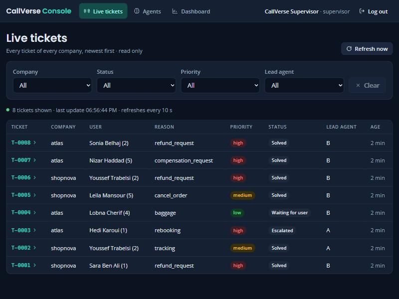
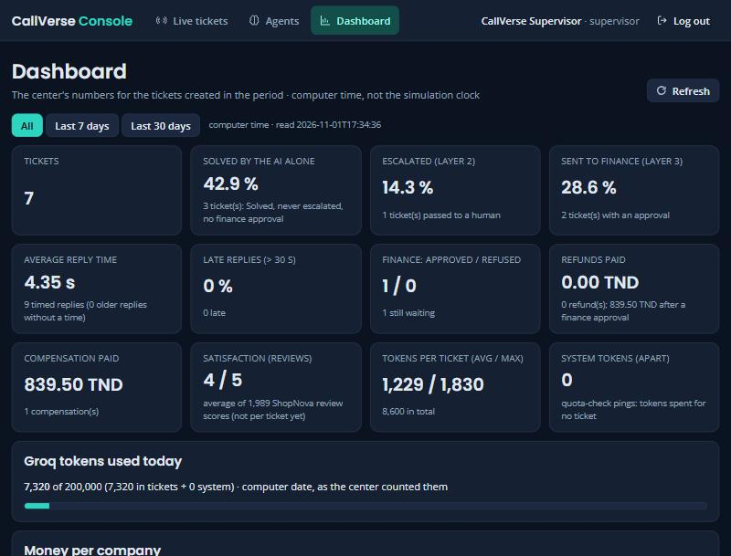
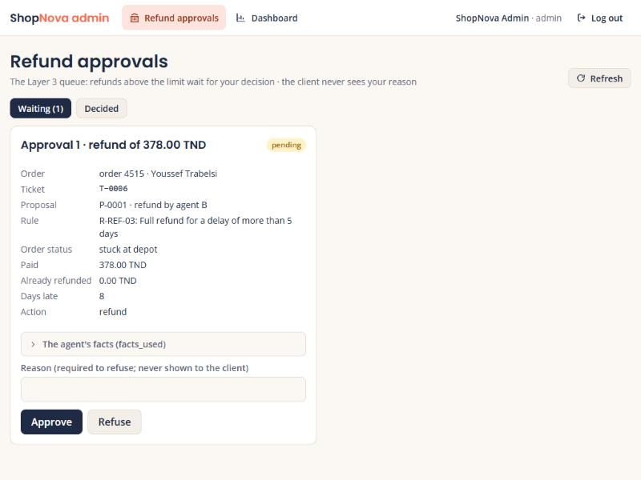
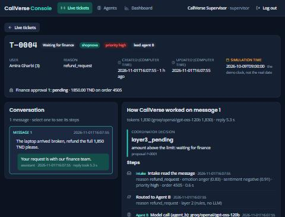

<div align="center">

# CallVerse

**A digital twin of a fully AI customer-relation center**

Multi-agent customer service where language models *propose* and plain rules *decide*.
Two fictional companies, real public datasets, local small models, text, voice and photo channels.


*University team project (6 students). Prototype, runs on one PC.*

</div>

---

## What it is

CallVerse simulates the customer-service center of a company that has **no human agents in the first line**.
A customer writes (or speaks, or sends a photo); a pipeline of small models and fixed rules reads the message,
picks the right AI agent, checks the facts in the company's database, and answers. Anything risky (large refunds,
compensation) goes to a human for approval.

The center serves two fictional companies through the same pipeline:

| Company | Sector | Data it runs on |
|---|---|---|
| **ShopNova** | Electronics e-commerce (Tunisia, prices in TND) | 2,000 real orders from the Olist dataset, with generated clients and products |
| **Atlas Travel** | Hotel stays and flights | 2,000 real hotel bookings (Hotel Booking Demand) and 2,000 real flights (US DOT 2015 delays) |

The project's main idea is a **separation of powers**: a language model can be fluent and still wrong, so the
model is never the last step before the database.

## Architecture

```
 Text chat · Voice · Photo
            │
            ▼
 ┌─────────────────────┐   reason (embeddings), emotion, sentiment, priority,
 │  Intake  (no agent) │   language, style, order number. Small local models.
 └─────────┬───────────┘
           ▼
 ┌─────────────────────┐
 │  Queue router       │   plain rules + a priority queue
 └─────────┬───────────┘
           ▼
 ┌──────────────────────────────────────────────────────────────┐
 │ Agent A  Status & Tracking      Agent B  Payment & Refund    │  read tools only,
 │ Agent C  Urgent & Special Help  Agent D  Availability/Supply │  they PROPOSE actions
 └─────────┬────────────────────────────────────────────────────┘
           ▼
 ┌─────────────────────┐   re-reads the real data, checks the cited rule,
 │  Coordinator        │   the limits and the client's confirmation.
 │  (rules, NO LLM)    │   The only component allowed to write.
 └─────────┬───────────┘
           ├── above the limit ──► finance approval (human, in the admin UI)
           ▼
 ┌─────────────────────┐
 │  Reply writer (SLM) │   small local model, sees only the decision
 └─────────────────────┘
```

**The four safety rules**

1. **Agents only propose.** They read through tools; an action tool (refund, replacement) only creates a proposal.
2. **Only the Coordinator executes.** It never trusts the agent's facts: it re-reads the data, checks the policy
   rule and the client's own confirmation, then approves, sends back, asks the client, declines or escalates.
3. **Allow-list per agent, enforced in code.** A model only sees its own tools; any other call is refused and logged.
4. **Every step is traced.** One JSON line per step (who, input, output, tools, time), so any answer can be replayed.

Facts come from tools, never from model memory. More detail: [docs/architecture.md](docs/architecture.md).

### The agents

| Agent | Job | Model |
|---|---|---|
| **A** Status & Tracking | "Where is my order / flight?" | fine-tuned local model, local fallback |
| **B** Payment & Refund | Finds the company rule by meaning (RAG), proposes refunds | fine-tuned local model, then Groq `gpt-oss-120b` → `gpt-oss-20b` → Gemini Flash |
| **C** Urgent & Special Help | Replacement, hold, rebooking, special assistance | fine-tuned local model, Groq backup |
| **D** Availability & Supply | Stock vs sales, promotions and hotel deals for the owner to approve | fixed rules |

## Screenshots

<table>
<tr>
<td width="50%"><br><sub><b>Console, live tickets</b>: every ticket of every company, filters, refreshed every 10 s</sub></td>
<td width="50%"><br><sub><b>Console, dashboard</b>: solved by AI alone, escalations, finance, reply time, tokens</sub></td>
</tr>
<tr>
<td width="50%"><br><sub><b>Refund approvals</b>: a refund above the limit waits for the admin's decision</sub></td>
<td width="50%"><br><sub><b>Ticket detail</b>: every step of how the center worked on a message</sub></td>
</tr>
</table>

## Features

- **Two companies, one center.** Each company has its own reasons, rules, tools and approval limits. The company comes
  from the channel, never from the message text.
- **Rule-based decisions.** The Coordinator approves, sends back (max 2 times), asks the client, declines with the
  rule's reason, or escalates. Refunds above 300 TND (ShopNova) or 1,500 TND (Atlas), and every compensation, wait for a human.
- **A write must match what the client asked.** "Cancel this payment" is not an order cancellation; a refund needs the
  client's own money-back words. Checked by code, with no model.
- **Three channels.** Text chat, voice (speech-to-text, spoken reply) and photo check of damaged goods.
- **Photo evidence, late fusion.** A vision model says only what a photo *shows*; the text says what the client *wants*;
  fixed rules join them. The photo can supply the "photo proof" a rule asks for, and nothing else.
- **Console for the supervisor** (read only): live tickets, step-by-step ticket detail, one card per agent, dashboard.
- **Owner screens:** refund approvals, promotions (ShopNova), hotel deals (Atlas), "check stock / rooms now".
- **Client Simulator** that plays customers so the agents can be tested without real clients.
- **Reply styles** (short, warm, warm + next step) chosen per situation by an experimental bandit policy (off by default).

## Results

Everything below was measured in the repo; held-out sets were read once, at the end, and nothing was tuned afterwards.

| What | Result |
|---|---|
| Agents A and B, 60 real customer messages | Fine-tuned model **56/56**, 0 wrong writes (base local model: 46/56) |
| ShopNova decline check, held-out | 11/12, 0 crashes, 0 leaks, 0 wrong writes |
| Agents C and D, held-out | **6/10** (D 3/3, C 3/7). Agent C proposed actions when the facts said "no"; the Coordinator caught every case, **0 wrong writes** ([finding](docs/findings_agent_c.md)) |
| Embeddings for Intake and rule search | 7 options benchmarked ([table](docs/benchmarks/M3.md)). `bge-base` won on validation but its p95 latency on the demo PC (124–134 ms) broke the 100 ms limit, so `bge-small` stays. Fine-tuned and LoRA variants **lost** on validation and were not adopted |
| Photo check (Qwen3-VL-2B + QLoRA), 25 held-out real photos | Accuracy **0.84** vs 0.64 for the base model with an improved prompt (+0.20, 95% CI +0.08 to +0.36); damage recall 1.00; 100% valid JSON |
| Satisfaction predictor (Agent F), CPU, about 2 ms | MAE 0.644, Spearman 0.80 on 5,000 held-out Amazon reviews; MAE 0.55, 94% within ±1 star on a separate 100-review check |
| Client Simulator | Customer writer `gemma3:1b` (0.83 GB, 0.47 s per message); satisfaction scorer MiniLM int8 (about 10 ms), MAE 0.80 on 1,000 real CSAT rows |
| Live demo, all local models | Refund approved by code in 38 s; reply writer and agents run on one PC, **0 API tokens** |
| Tests | 2,000+ Python tests and 80+ frontend tests, no API key or model needed |

## Demo flows

Run live on the real local models (full list and exact messages in [docs/DEMO_RUNBOOK.md](docs/DEMO_RUNBOOK.md)):

| Customer says | What happens |
|---|---|
| *"My order 4512 is very late. I want my money back."* | Agent B proposes a refund, the Coordinator checks the rule and approves it, the ticket is solved |
| *"My order 4515 never arrived. I want a refund."* (378 TND) | Above the limit: waits for finance. The admin approves, the refund is written once, the reply is sent |
| *"My flight 7004 was very delayed. I want compensation."* | Same center, second company, its own rules; the Atlas admin approves 839.50 TND |
| *"Order 4512 is late and I need it tomorrow."* then *"Yes"* | Agent C offers a free replacement and asks first; only after the "Yes" does the Coordinator create it |
| *"My flight was cancelled. Put me on the next flight."* | No later flight exists: escalated to a colleague, with a clear message |

## Quick start (Windows, Python 3.12)

```powershell
python -m venv .venv
.venv\Scripts\activate
pip install -r requirements.txt
copy .env.example .env            # add your own API keys (git-ignored)
python -m callverse.data.seed     # builds the ShopNova database
python -m scripts.run_demo "Hi, where is my order 4512?"
python -m pytest -q --ignore=tests/data
```

- **Local models** run in [Ollama](https://ollama.com): `qwen2.5:1.5b` (reply writer), plus the agents' model.
  The fine-tuned agents' weights are **not in this repo**; without them the agents use the local test model or the Groq backups.
- **Full demo with the web UI:** `Demo.bat` starts Ollama, the API (`:8610`) and the React UI (`:5173`).
  `Reset.bat` restores clean data. Accounts and exact messages: [docs/DEMO_RUNBOOK.md](docs/DEMO_RUNBOOK.md).
- Optional extras: `requirements-voice.txt` (voice channel), `requirements-vision.txt` (photo check), `requirements-simulator.txt` (Client Simulator).
- Atlas Travel and the Console also run as Streamlit apps (`Atlas.bat`, `Console.bat`, `ShopNova.bat`).

## Tech stack

| Area | Tools |
|---|---|
| Agents and LLMs | Qwen3-4B (fine-tuned, LoRA), `qwen2.5:1.5b` reply writer, Groq `gpt-oss-120b` / `gpt-oss-20b`, Gemini Flash, Ollama |
| Intake and search | `bge-small-en-v1.5` embeddings, emotion and sentiment classifiers, RAG over company policies |
| Vision and voice | Qwen3-VL-2B + QLoRA adapter (Hugging Face), Groq Whisper (faster-whisper backup), Piper TTS |
| Backend | Python, FastAPI, SQLite, pytest |
| Frontend | React, Vite, Vitest; Streamlit apps for the first versions |
| ML work | scikit-learn (satisfaction predictor), Kaggle notebooks (QLoRA training), benchmark scripts |

## Project structure

```
callverse/          the code
  intake/             reason, emotion, sentiment, priority, language, style
  queues/             rule router and priority queue
  agents/             agents A, B, C, D and the shared agent loop
  tools/              read tools, proposal tools, per-agent allow-lists
  kb/                 company policies and the policy search (RAG)
  coordinator/        the rule-based Coordinator (ShopNova and Atlas gates)
  slm/                reply writer, its rule check, templates, reply styles
  vision/ web/        photo check, voice and web channel
  learning/ quality/  reply-style policy, satisfaction predictor
  data/               company databases, the only write functions, clock
webui/              React + FastAPI web UI (customer, admin, supervisor)
apps/               Streamlit apps (ShopNova, Atlas Travel, Console)
client_simulator/   the Client Simulator
benchmarks/         embeddings, satisfaction, vision and speech benchmarks
docs/               architecture, contracts, runbook, findings
tests/              pytest tests
```

## Honest limits

- It is a **prototype on fictional companies**: the data is real but moved, re-priced and anonymised; nothing is connected to a real shop.
- Agent C is a language model and still proposes wrong actions sometimes (6/10 on the hidden set). The design is the
  answer: the Coordinator catches them. The model is never trusted with a write.
- The photo check was measured on only **25 held-out photos** (wide confidence interval).
- The voice website has not been tested live; the reply-style policy is experimental, off by default, and was trained on a synthetic reward.
- The satisfaction predictor is trained on Amazon reviews, not on CallVerse conversations.
- The fine-tuned model weights and the adapters are not in the repo.

## Team

Team project of six students: Ayoub Rebhi, Mahmoud Ben Khelil, Medali Mraihi, Molka Boukhris, Semah Ayachi and Yassine Maazaoui.

| Who | Main contribution |
|---|---|
| **Yassine Maazaoui** | The core pipeline: Intake, queue router, agent loop and Agents A and B, the Coordinator, policy search, the reply writer, tickets, the Console, the embeddings benchmark, integration of the team's branches |
| **Medali Mraihi (Dali)** | The platform and data layer, the web server, the React web UI, Agents C and D, the fine-tuned agent model |
| **Molka Boukhris** | The voice and photo channel (speech and vision benchmarks, web channel) |
| **Semah Ayachi** | The satisfaction predictor (Agent F) and the vision QLoRA adapter |
| **Mahmoud Ben Khelil** | The Client Simulator |

## Data and licences

- **Code:** MIT, see [LICENSE](LICENSE).
- **Data:** Olist (CC BY-NC-SA 4.0), Hotel Booking Demand (CC BY 4.0), US DOT 2015 Flight Delays (CC0), ABCD (MIT, benchmark only).
  Sources, credit lines and the changes made: [DATA_LICENCES.md](DATA_LICENCES.md). The Olist-derived sample keeps
  its non-commercial licence, so the project is for non-commercial, educational use. Raw datasets are never committed.

## Docs

[Architecture](docs/architecture.md) · [Demo runbook](docs/DEMO_RUNBOOK.md) · [Platform contract](docs/platform_contract.md) ·
[Decision format](docs/decision_format.md) · [Embeddings benchmark](docs/benchmarks/M3.md) · [Photo check](docs/vision_integration.md) ·
[Voice channel](docs/voice_channel.md) · [Agent F](docs/agent_f.md) · [Finding on Agent C](docs/findings_agent_c.md) · [Client Simulator](client_simulator/README.md)
