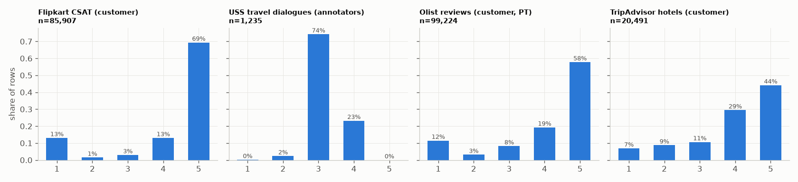
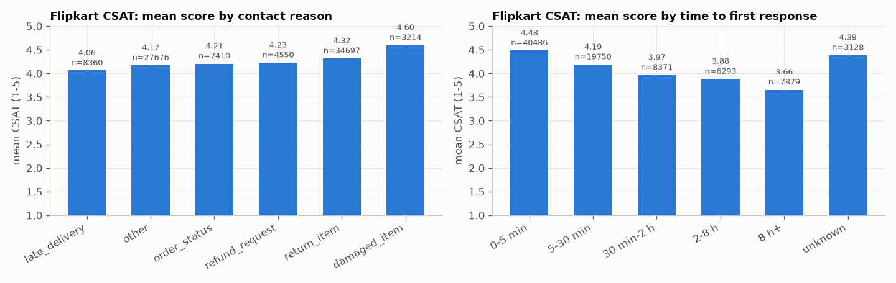
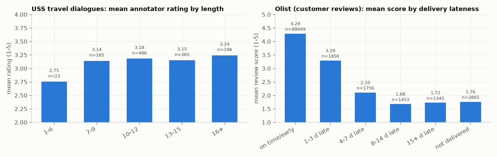

# D6 - Real conversations / reviews with satisfaction scores (M7)

Owner: Client Simulator. Every number below comes from `scripts/p1_build_real_scores.py` and
`scripts/p1_stats_baselines.py` (results in `data/processed/real_scores/build_info.json`,
`results/p1_real_stats.json`, `results/p1_baselines.json`), or from the cited source page.

## The team's table

| Dataset | Link | Licence | Text type (conversation / review) | Score type | Size | Language | Notes |
|---|---|---|---|---|---|---|---|
| eCommerce Customer Service Satisfaction ("Shopzilla", Flipkart-style) | [kaggle ddosad](https://www.kaggle.com/datasets/ddosad/ecommerce-customer-service-satisfaction) | **to verify** (Kaggle says "other", no licence named) | short customer remark after a support contact | CSAT 1-5, **given by the customer** | 85,907 contacts; 28,742 with a remark | English (Indian English, some Hinglish) | Real CSAT per the uploader; agent/customer identifiers were replaced with Faker values by the uploader. Has category, sub-category, report and response timestamps -> maps to all ShopNova labels and gives response-time buckets. Best fit to ShopNova, but licence unclear. |
| User Satisfaction Simulation (USS), English MultiWOZ + SGD parts | [github sunnweiwei/user-satisfaction-simulation](https://github.com/sunnweiwei/user-satisfaction-simulation), paper [arXiv 2105.03748](https://arxiv.org/abs/2105.03748) | **to verify** (no licence found: see "Licence check" below; underlying MultiWOZ 2.1 is MIT, SGD is CC BY-SA 4.0) | task-oriented **conversation** (user/system) | dialogue-level 1-5, **given by annotators** (paper: 40 invited annotators, 3 per dialogue, "expert ratings", Fleiss kappa 0.574; the released file has 3-7 ratings per dialogue; we use the mean rounded half up) | 2,000 English dialogues in MWOZ+SGD; 1,235 travel dialogues kept (822 MWOZ, 413 SGD) | English | Not real customers: MultiWOZ is human-human Wizard-of-Oz role-play; SGD dialogues were machine-outlined then paraphrased by crowd workers. Ratings are very compressed: 74% are 3, no 5s in the travel subset. Travel filter: MWOZ hotel/train/taxi actions, SGD travel keywords. |
| Olist Brazilian E-Commerce, order reviews | [kaggle olistbr](https://www.kaggle.com/datasets/olistbr/brazilian-ecommerce) | CC BY-NC-SA 4.0 (academic use allowed) | short **review** after delivery | review_score 1-5, **given by the customer** | 99,224 reviews; 40,977 with a comment | **Portuguese** | Joins to order dates -> delivery lateness vs score (strongest real driver we found). Used for statistics only; not translated into the English sets. |
| Trip Advisor Hotel Reviews | [kaggle andrewmvd](https://www.kaggle.com/datasets/andrewmvd/trip-advisor-hotel-reviews), source: Alam et al. 2016, [doi:10.5281/zenodo.1219899](https://doi.org/10.5281/zenodo.1219899) | CC BY-NC 4.0 (academic use allowed) | hotel **review** | rating 1-5, **given by the customer** | 20,491 reviews | English | Travel (hotels) -> Atlas booking/stay experience. Not a support conversation: it rates the stay, not a service contact. |
| Airline Reviews (airlinequality.com / Skytrax) | [kaggle juhibhojani](https://www.kaggle.com/datasets/juhibhojani/airline-reviews) | DbCL-1.0 on Kaggle, but content scraped from airlinequality.com -> **to verify** | airline **review** | Overall_Rating, **given by the customer** (values 1-9 and "n" in the file; site scale is 1-10, to verify) | 23,171 reviews | English | Travel (flights). Not the same 1-5 scale. Kept as a candidate only. |
| Customer Support Ticket Dataset | [kaggle suraj520](https://www.kaggle.com/datasets/suraj520/customer-support-ticket-dataset) | CC0-1.0 | ticket description | 1-5 rating | 8,469 tickets; 2,769 rated | English | **Rejected: generated.** 100% of descriptions contain the unfilled template text `{product_purchased}`, and the ratings are uniform (553/549/580/543/544). |
| Twitter US Airline Sentiment | [kaggle crowdflower](https://www.kaggle.com/datasets/crowdflower/twitter-airline-sentiment) | CC BY-NC-SA 4.0 | tweet | 3-class sentiment by annotators (not 1-5) | 14,640 tweets | English | No 1-5 score -> used in D5 (messages, reason mix), not D6. |
| Airline Quality Ratings (passenger satisfaction survey) | [kaggle mikhail1681](https://www.kaggle.com/datasets/mikhail1681/airline-quality-ratings) | other -> to verify | none | satisfaction label + 1-5 sub-ratings | 120,000+ (per page) | - | **Skipped: score but no text.** Not downloaded. |

## What we built (`data/processed/real_scores/`, git-ignored; rebuilt by `python scripts/p1_build_real_scores.py`)

- **CONV** (`conv_{train,dev,test}.jsonl`): 1,235 USS travel dialogues, anonymised, with every annotator rating, the
  mean, and the rounded 1-5 score. Split 864 / 185 / 186 (seed 42, stratified by score; scores 1 and 5 were merged
  into 2 and 4 for the stratify key only because they are too rare).
- **CSAT** (`csat_all.jsonl` and `csat_allrows_*`): all 85,907 rows for statistics, split 60,134 / 12,886 / 12,887.
  `csat_text_*`: the 28,742 rows with a remark, split 20,119 / 4,311 / 4,312. Each row has the mapped ShopNova
  reason, minutes to first response and a delay bucket. Agent, supervisor and manager names (Faker values) are
  dropped, and any of those names in remarks become `<NAME>`.
- Category -> ShopNova label mapping (sub-category based, in `p1_build_real_scores.py`): Delayed, Priority delivery ->
  late_delivery; Order status enquiry, Unable to track, Order Verification, General Enquiry (Order Related) ->
  order_status; Refund Enquiry, Refund Related Issues, COD Refund Details -> refund_request; Reverse Pickup Enquiry,
  Return request, Exchange / Replacement, Return cancellation, Wrong -> return_item; Damaged, Product related Issues,
  Missing -> damaged_item; everything else (installation, payments, app, feedback, cancellations, ...) -> other.
- 3,128 CSAT rows (3.6%) have a negative or missing response time (responded before reported); they are kept for
  score statistics with delay bucket "unknown".

## Real score statistics (charts in `reports/figures/`)

| Set (who scored) | n | mean | share of 1s | share of 5s |
|---|---|---|---|---|
| Flipkart CSAT (customer) | 85,907 | 4.24 | 13.1% | 69.4% |
| USS travel dialogues (annotators) | 1,235 | 3.21 | 0.2% | 0.0% |
| Olist reviews (customer, PT) | 99,224 | 4.09 | 11.5% | 57.8% |
| TripAdvisor hotels (customer) | 20,491 | 3.95 | 6.9% | 44.2% |

**What drives low vs high scores (real data):**
1. **Waiting time before the first answer** (Flipkart, customer CSAT): mean 4.48 when answered within 5 min
   (n=40,486), 4.19 at 5-30 min, 3.97 at 30 min-2 h, 3.88 at 2-8 h, 3.66 after 8 h (n=7,879). The share of 1s
   rises from 7.9% to 26.4%.
2. **Delivery lateness** (Olist, customer reviews): mean 4.29 on time or early (n=89,949), 3.29 at 1-3 days late,
   2.10 at 4-7 days, 1.68 at 8-14 days, 1.72 at 15+ days, 1.76 when never delivered. Share of 1s goes from 6.6% to
   about 70%.
3. **Contact reason** (Flipkart): late_delivery is lowest (4.06, 16.9% ones), damaged_item highest (4.60) -
   damaged items are usually replaced, so the contact itself resolves well. Email contacts score lower (3.90) than
   inbound calls (4.25) or outcalls (4.27).
4. **The customer writing a remark at all** signals trouble: rows with a remark average 4.07 vs 4.33 without, and
   remarks given with scores 1-3 are about twice as long (median 6-7 words) as with 4-5 (median 3 words).
5. **Annotators (USS) barely use the ends of the scale**: 74% of travel dialogues are 3. Short dialogues
   (1-6 user turns) average 2.75 vs about 3.15-3.24 for longer ones; dialogues where any user turn was rated
   <= 2 average 2.90 vs 3.23.
6. Agent tenure barely matters (4.15 for agents in training vs 4.26-4.35 for others).

## Baselines on the test sets (same metrics everywhere)

| Test set | Model | n | MAE | Spearman | exact acc | +-1 acc | QWK | macro-F1 | Wasserstein |
|---|---|---|---|---|---|---|---|---|---|
| CONV | majority (3) | 186 | 0.263 | n/a | 0.742 | 0.995 | 0.000 | 0.170 | 0.263 |
| CONV | TF-IDF + LR (C=10, balanced) | 186 | 0.323 | 0.000 | 0.683 | 0.995 | 0.007 | 0.187 | 0.161 |
| CSAT, rows with remark | majority (5) | 4,312 | 0.927 | n/a | 0.684 | 0.775 | 0.000 | 0.162 | 0.927 |
| CSAT, rows with remark | TF-IDF + LR (C=1) | 4,312 | 0.500 | 0.624 | 0.794 | 0.879 | 0.675 | 0.322 | 0.193 |
| CSAT, all rows | majority (5) | 12,887 | 0.758 | n/a | 0.694 | 0.825 | 0.000 | 0.164 | 0.758 |
| CSAT, all rows | TF-IDF + LR (C=3) | 12,887 | 0.630 | 0.346 | 0.725 | 0.856 | 0.363 | 0.257 | 0.515 |

LR features: dialogue text (CONV); remark + reason + delay bucket + channel tokens (CSAT). C and class weight were
chosen on dev by QWK; test was not used for tuning. Note how hard CONV is: the text carries almost no signal for the
annotator score (QWK 0.007), and always answering 3 already gives MAE 0.263.

## 10 sample rows (anonymised; text + score + who scored)

| # | Set | Text (excerpt) | Score | Scored by |
|---|---|---|---|---|
| 1 | CSAT, return_item, waited 8 h+ | "Shopzilla not good work" | 1 | customer |
| 2 | CSAT, other, waited 0-5 min | "language telling about customers care support" | 2 | customer |
| 3 | CSAT, late_delivery, 0-5 min | "My work is not resolved" | 3 | customer |
| 4 | CSAT, other, 8 h+ | "Wrong description of the product" | 4 | customer |
| 5 | CSAT, late_delivery, 0-5 min | "Very good person I am very happy your talking ??" | 5 | customer |
| 6 | CONV (MWOZ, 13 user turns) | U: I want to take a train from Stevenage to Cambridge. / A: What day and time do you want to leave Stevenage? / U: I would like to leave on Monday and arrive in cambridge by 12:45. ... | 2 (ratings 2,3,2) | 3 annotators |
| 7 | CONV (MWOZ, 12 user turns) | U: I need to find a place to sleep on the east side, it doesnt matter is the parking is free or not. / A: There are 7. Would you like to stay in a guesthouse, or a hotel? ... | 3 (ratings 2,3,3) | 3 annotators |
| 8 | CONV (MWOZ, 11 user turns) | U: Can you help me find a moderately priced restaurant in the center of town? / A: Sure, I can help with that. ... | 4 (ratings 3,4,4) | 3 annotators |
| 9 | TripAdvisor | "bali garden o.k, family stayed bali garden hotel 7 days sure cremation site pool construction fine cheap holiday ..." | 2 | customer |
| 10 | Olist (Portuguese, not translated) | "Produto de péssima qualidade, ja chegou com o cronômetro quebrado e os botões com defeito" | 1 | customer |

Rows 1-5 show how noisy real CSAT is: a "not resolved" remark can still come with a 3, and a negative product
remark with a 4.

## Licence check (follow-up, 2026-10-25)

**eCommerce Customer Service Satisfaction (Kaggle ddosad)** - still **to verify**.
- Kaggle API metadata (`kaggle datasets metadata -d ddosad/ecommerce-customer-service-satisfaction`, saved in
  `data/raw/meta/`): `"licenses": [{"name": "other"}]`, `"userSpecifiedSources": "-"`.
- The description (full text in the metadata) contains no licence, no terms of use and no original source. It says:
  "the authentic information has been obfuscated, and the dataset has been fabricated using the Faker library to
  ensure the concealment of genuine details". The subtitle is "Real World Data for EDA, Classification".
- The Kaggle web page ([link](https://www.kaggle.com/datasets/ddosad/ecommerce-customer-service-satisfaction)) is
  rendered by JavaScript; our fetch returned only the title, so the licence label on the page could not be read
  beyond the API value "other".

**USS (sunnweiwei/user-satisfaction-simulation)** - still **to verify**.
- GitHub API: `"license": null`; the repository tree has no LICENSE file (files: README.md, dataset/*, baselines/*,
  imgs/*, .idea/*).
- [README.md](https://github.com/sunnweiwei/user-satisfaction-simulation/blob/master/README.md) and
  [dataset/README.md](https://github.com/sunnweiwei/user-satisfaction-simulation/blob/master/dataset/README.md):
  describe the format and ask for citation; no licence or terms.
- Paper ([arXiv 2105.03748](https://arxiv.org/abs/2105.03748)): "We share the USS dataset at
  https://github.com/sunnweiwei/user-satisfaction-simulation." No licence or terms for the data. The paper itself is
  under the arXiv non-exclusive distribution licence 1.0 and carries the ACM notice "posted here for your personal
  use. Not for redistribution" - this covers the paper, not the dataset.

Because both stay unclear, a **fallback calibration built only from confirmed-licence data** (Olist CC BY-NC-SA 4.0,
TripAdvisor CC BY-NC 4.0) ships as `simulator/calibration_fallback.json`; see SCORE_CALIBRATION.md section 7.

## Choice and licence status

- **Best fit for calibration and testing, used in Phase 3:** Flipkart CSAT (real customer scores, ShopNova reasons,
  response times) and USS-EN travel dialogues (the only real-text conversations with dialogue-level ratings we
  found). **Both licences are "to verify"**, so under the team rule neither is a final pick until the licence
  is confirmed (ask the Kaggle uploader / the USS authors - see BLOCKERS.md).
- **Final pick with a confirmed licence:** **Trip Advisor Hotel Reviews** (CC BY-NC 4.0, English, real customer 1-5,
  travel) as the scored-text set, plus **Olist** (CC BY-NC-SA 4.0, real customer 1-5) for the e-commerce score
  statistics (delivery lateness -> score). Both allow academic, non-commercial use with attribution
  (and share-alike for Olist).
- Not chosen: Airline Reviews (scraped, licence to verify, 1-10 scale), the CC0 ticket dataset (generated),
  airline passenger survey (no text).
