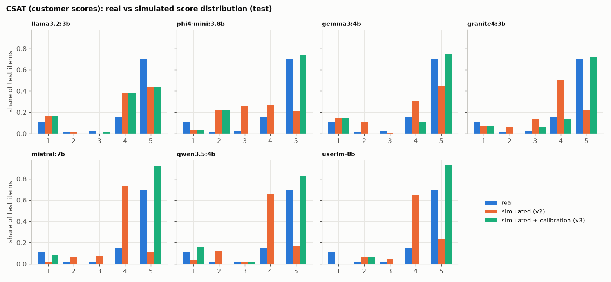
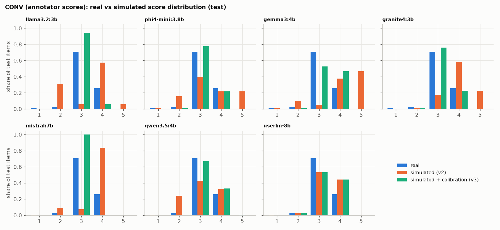
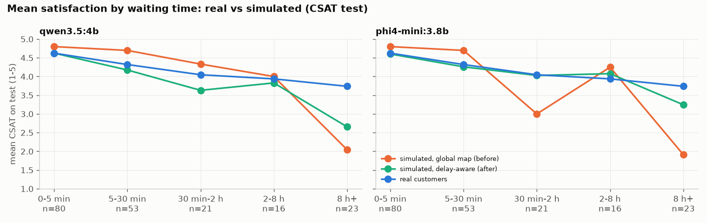

# Does the simulator's 1-5 score match real scores? (the full story)

**Judging note.** Realism and stays-in-role scores (0-6) were judged by Claude Code (Test 1 blind: anonymous codes, shuffled order) and were **not hand-verified** by a person. The outputs are in JUDGE_SPOTCHECK.md and JUDGE_SPOTCHECK_FINAL.md for review.

**Short answer.** Partly. On real customer CSAT, the chosen simulator (qwen3.5:4b, prompt v2 + calibration map)
reaches test QWK 0.33 and MAE 0.80 on 200 real contacts. That clearly beats random agreement and the "always 5"
majority baseline on QWK (0.00), but not on MAE (0.68). A supervised TF-IDF model trained on the same data does
better (QWK 0.42, MAE 0.55). On annotator ratings of travel dialogues, nothing works well: the best test QWK is
about 0.2, and nothing beats "always 3" on MAE. Calibration mainly fixes the *distribution* of scores (Wasserstein
0.67 -> 0.24 on CSAT); it adds little item-level accuracy. All numbers below are on held-out **test** items, and
every choice was made on **dev**. Result files: `results/p3_test3_scores.json`, `results/p3_bootstrap.json`.

**What the simulator is validated for - and what it is not.** The Client Simulator is validated for realistic
satisfaction-score **distributions**: its calibrated scores match the real customer CSAT distribution overall
(Wasserstein distance 0.24 on test vs 0.68 for "always 5"), and with the delay-aware calibration the mean score per
waiting-time bucket is on average within 0.22 points of the real mean (still too low for waits over 8 hours). It is **not** a
per-conversation satisfaction predictor: its item-level agreement with real scores is modest (test QWK 0.33).
Predicting the satisfaction of one specific conversation is **M7's job** (agent F's predictor). The bar M7 must beat
is the CPU baseline from D6: **TF-IDF + logistic regression, QWK 0.42 (MAE 0.55) on the 200-row CSAT test sample**
used for all model comparisons (on the full CSAT test split: QWK 0.363 over all 12,887 rows, 0.675 over the 4,312
rows that have a customer remark; `results/p1_baselines.json`, `results/p3_test3_scores.json`). An M7 model that
does not beat these numbers on the same test rows adds nothing over the baseline.

## 1. The real data and who scored it

| Set | What the simulator sees | Real score given by | Licence |
|---|---|---|---|
| **CSAT** - eCommerce Customer Service Satisfaction (Flipkart-style "Shopzilla"), 85,907 contacts | a situation card built from a real row: channel, contact reason (mapped to ShopNova labels), sub-category, waiting time until the first answer, and the customer's own remark if they wrote one (33% did) | **the customer** (post-contact CSAT survey, 1-5) | to verify (Kaggle "other") |
| **CONV** - USS, English MultiWOZ + SGD travel dialogues, 1,235 dialogues | the whole dialogue plus the user's goal (their first message) | **annotators** (the USS paper: 40 invited annotators, 3 per dialogue; the released file has 3-7 ratings per dialogue; we use the mean, rounded half up) | to verify (no LICENSE file) |

Real distributions are very different: CSAT is 69% fives and 13% ones (customers use the ends of the scale);
CONV is 74% threes and has no fives in the travel subset (annotators avoid the ends). See D6_satisfaction.md.

## 2. How the simulator score was tested

- **Splits.** Each set was split train / dev / test (70/15/15, seed 42, stratified by score). Natural-distribution
  samples: CSAT calibration 100 (from train), dev 100, test 200; CONV calibration 60 (from train), dev 60, test 120.
  The few-shot examples come from train and are excluded from the calibration sample.
- **Three versions per model.**
  - **v1 plain**: "You are the customer described below... rate 1-5 and write a one-line comment", fixed JSON format.
  - **v2 rubric + real few-shot**: v1 plus rubric lines computed from the **train** split only (e.g. "Out of 100
    real customers, 69 give 5, 13 give 4, 3 give 3, 1 give 2 and 13 give 1"; "answered in under 5 minutes the
    average is 4.48; after more than 8 hours it is 3.65 and 26% give 1"; negative remarks -> 1 in 64% of cases) and
    balanced real examples (CSAT: one real row per score 1-5, with the customer's real remark as the comment;
    CONV: one real dialogue per score 2, 3, 4 - USS has no comments, so those three example comments were written
    by us; the scores are real). Exact text: `results/p3_rubrics_from_train.json`.
  - **v3 = v2 + calibration map.** Three maps from raw score to real score, each fitted on the calibration sample:
    median real score per raw score, isotonic regression (rounded), and quantile matching (map the raw score's
    mid-rank quantile to the real quantile). The map with the best dev QWK is v3.
- **Selection.** For each model and set, the version with the highest **dev** QWK (tie: lower Wasserstein) is chosen;
  test numbers are then reported once. Temperature 0. Metrics are the same as for the baselines
  (`scripts/common.py: score_metrics`).

## 3. Results - before and after calibration, next to the baselines (test)

**CSAT (real customer scores, n = 200)**

| Model / baseline | chosen on dev | MAE | Spearman | exact | +-1 | QWK | macro-F1 | Wasserstein |
|---|---|---|---|---|---|---|---|---|
| majority "always 5" (baseline) | - | 0.68 | n/a | 0.70 | 0.85 | 0.00 | 0.16 | 0.68 |
| TF-IDF + logistic regression (baseline, trained on 60,134 real rows) | - | 0.55 | 0.36 | 0.73 | 0.89 | 0.42 | 0.27 | 0.44 |
| **qwen3.5:4b** v2, before calibration | | 1.03 | 0.28 | 0.28 | 0.83 | 0.32 | 0.23 | 0.67 |
| **qwen3.5:4b** v3, after calibration (quantile) | **v3** | **0.80** | 0.30 | 0.67 | 0.81 | **0.33** | 0.23 | **0.24** |
| **phi4-mini:3.8b** v2, before | | 1.38 | 0.24 | 0.25 | 0.56 | 0.20 | 0.19 | 1.07 |
| **phi4-mini:3.8b** v3, after (quantile) | **v3** | 0.93 | 0.24 | 0.59 | 0.74 | 0.27 | 0.24 | 0.36 |
| mistral:7b v2 before / v3 after (median) | v3 | 1.02 / 0.64 | 0.30 / 0.31 | 0.23 / 0.71 | 0.85 / 0.86 | 0.30 / 0.35 | 0.19 / 0.24 | 0.74 / 0.34 |
| granite4:3b v2 before / v3 after (quantile) | v2 | 1.11 / 0.70 | 0.24 / 0.30 | 0.27 / 0.62 | 0.77 / 0.84 | 0.30 / 0.39 | 0.18 / 0.29 | 0.67 / 0.11 |
| gemma3:4b v2 before / v3 after (quantile) | v2 | 1.11 / 0.85 | 0.27 / 0.25 | 0.45 / 0.62 | 0.74 / 0.81 | 0.26 / 0.27 | 0.22 / 0.25 | 0.53 / 0.10 |
| llama3.2:3b v2 before / v3 after (quantile) | v2 | 0.99 / 1.00 | 0.28 / 0.28 | 0.47 / 0.47 | 0.81 / 0.81 | 0.30 / 0.28 | 0.24 / 0.24 | 0.42 / 0.41 |
| userlm-8b v2 before / v3 after (median) | v3 | 0.97 / 0.63 | 0.18 / 0.29 | 0.28 / 0.69 | 0.86 / 0.86 | 0.23 / 0.28 | 0.18 / 0.19 | 0.66 / 0.47 |

**CONV (annotator ratings of real dialogues, n = 120)**

| Model / baseline | chosen on dev | MAE | Spearman | exact | +-1 | QWK | macro-F1 | Wasserstein |
|---|---|---|---|---|---|---|---|---|
| majority "always 3" (baseline) | - | 0.30 | n/a | 0.71 | 0.99 | 0.00 | 0.17 | 0.30 |
| TF-IDF + logistic regression (baseline) | - | 0.36 | -0.00 | 0.65 | 0.99 | 0.01 | 0.18 | 0.19 |
| **qwen3.5:4b** v2, before | | 0.60 | 0.18 | 0.46 | 0.94 | 0.18 | 0.22 | 0.30 |
| **qwen3.5:4b** v3, after (quantile) | **v3** | 0.40 | 0.18 | 0.61 | 0.99 | 0.18 | 0.22 | 0.12 |
| **phi4-mini:3.8b** v2, before | | 0.79 | 0.21 | 0.38 | 0.82 | 0.18 | 0.19 | 0.53 |
| **phi4-mini:3.8b** v3, after (quantile) | **v3** | 0.36 | 0.17 | 0.65 | 0.99 | 0.17 | 0.22 | 0.07 |
| mistral:7b v2 / v3 (median) | v2 | 0.71 / 0.30 | 0.22 / n/a | 0.31 / 0.71 | 0.98 / 0.99 | 0.19 / 0.00 | 0.17 / 0.17 | 0.64 / 0.30 |
| granite4:3b v2 / v3 (quantile) | v3 | 0.85 / 0.38 | 0.24 / 0.12 | 0.32 / 0.64 | 0.83 / 0.98 | 0.14 / 0.13 | 0.22 / 0.29 | 0.80 / 0.06 |
| gemma3:4b v2 / v3 (quantile) | v2 | 1.19 / 0.42 | 0.32 / 0.26 | 0.13 / 0.59 | 0.68 / 0.98 | 0.15 / 0.23 | 0.12 / 0.23 | 1.12 / 0.24 |
| llama3.2:3b v2 / v3 (quantile) | v3 | 0.87 / 0.31 | 0.18 / 0.10 | 0.23 / 0.70 | 0.91 / 0.99 | 0.17 / 0.07 | 0.13 / 0.20 | 0.72 / 0.24 |
| userlm-8b v1 (chosen) | v1 | 0.56 | 0.15 | 0.47 | 0.97 | 0.08 | 0.19 | 0.43 |

(UserLM's CONV dev choice was v1; its v1 test numbers come from the extra v1 test run, see `p3_test3_scores.json`.)

**Uncertainty.** With 200 / 120 test items the 95% bootstrap interval on QWK is about +-0.17: qwen3.5 CSAT
0.16-0.49, CONV 0.02-0.33. No model is significantly better than another (`results/p3_bootstrap.json`).

**What the rubric did (dev QWK, v1 -> v2):** it helped most models on CSAT (llama 0.23 -> 0.38, mistral 0.21 -> 0.32,
granite 0.20 -> 0.30), barely changed qwen3.5 (0.30 -> 0.31) and hurt phi4-mini (0.24 -> 0.21) and UserLM
(0.17 -> 0.14). Its main effect was format: it fixed phi4-mini's invalid JSON (95% / 45% -> 0%).

### Charts

Before calibration, every model piles up on 4 for CSAT (qwen3.5: 66% fours vs 16% real) and spreads CONV over 2-4.
The calibration map moves the mass to where real scores are: qwen3.5's CSAT map is 1->1, 2->1, 3->3, 4->5, 5->5.

### Does the simulator react to the same drivers as real customers? (CSAT test, qwen3.5:4b)

| Waiting time | n | real mean | simulated raw | simulated calibrated |
|---|---|---|---|---|
| 0-5 min | 80 | 4.62 | 4.15 | 4.80 |
| 5-30 min | 53 | 4.32 | 3.96 | 4.70 |
| 30 min-2 h | 21 | 4.05 | 3.71 | 4.33 |
| 2-8 h | 16 | 3.94 | 3.50 | 4.00 |
| 8 h+ | 23 | 3.74 | 2.35 | 2.04 |

Direction is right (longer wait -> lower score) but the simulator **overreacts** to very long waits (2.04 vs 3.74
real). By reason the ordering is not reproduced (e.g. damaged_item: real 4.83, calibrated 4.33, n = 6; the
per-reason groups are small). Rows with a remark: real 4.03, calibrated 3.45; without: real 4.46, calibrated 4.76.

## 3b. Delay-aware calibration (follow-up)

**Why it matters for agent E.** Agent E learns from the simulator's score as its reward. The reward's slope with
respect to waiting time tells E how much a faster answer is worth. Real customers lose about 0.9 points between
"answered in 5 minutes" (4.62 on test) and "after 8 hours" (3.74). The global-map simulator lost 2.8 points
(4.80 -> 2.04): about three times too steep. A policy trained on that reward would over-value speed - for example,
sending fast but incomplete answers, or skipping a slower, correct escalation - because the simulator punishes
waiting far more than real customers do. A reward with the wrong shape teaches the wrong trade-off, even when its
overall average looks right. Matching the per-bucket means fixes the reward's slope, which matters more for RL than
item-level accuracy.

**Method** (`scripts/p6_followup.py`, results `results/p6_followup.json`). The v2 prompt was run on 300 CSAT
calibration rows from **train** (the first 100 are the Phase 3 calibration sample). For each waiting-time bucket,
the target is the real score distribution of that bucket in the whole **train** split (60,134 rows). Candidates:
(1) the Phase 3 global map; (2) the global map refitted on 300 rows; (3) a per-bucket integer quantile map;
(4) a per-bucket **expected-score** map: each raw level maps to the mean real score over that level's quantile
interval in the bucket, which gives a continuous score (1.0-5.0). Buckets with fewer than 20 calibration rows
(2-8 h had 15) use the global map. Selection on **dev**: the smallest size-weighted gap between simulated and
real bucket means; dev QWK is reported alongside. Candidate (4) was added after (3) failed to move the 8 h+ bucket:
with 5 discrete raw levels, an integer quantile map cannot split a tie. **Dev chose (4) for both models.** Kit
output: `expected_score` (continuous; use it for agent E) and `score` (rounded).

**Mean score per waiting-time bucket on test (real vs simulated)**

| Waiting time | n | real | qwen3.5 raw | qwen3.5 before (global map) | **qwen3.5 after (delay-aware)** | phi4-mini before | **phi4-mini after** |
|---|---|---|---|---|---|---|---|
| 0-5 min | 80 | 4.62 | 4.15 | 4.80 | **4.63** | 4.80 | **4.60** |
| 5-30 min | 53 | 4.32 | 3.96 | 4.70 | **4.17** | 4.70 | **4.26** |
| 30 min-2 h | 21 | 4.05 | 3.71 | 4.33 | **3.63** | 3.00 | **4.03** |
| 2-8 h | 16 | 3.94 | 3.50 | 4.00 | **3.83** | 4.25 | **4.08** |
| 8 h+ | 23 | 3.74 | 2.35 | 2.04 | **2.66** | 1.91 | **3.25** |
| size-weighted mean gap to real | | | 0.534 | 0.415 | **0.224** | 0.534 | **0.099** |

**Overall test metrics (n = 200; integer score = expected score rounded)**

| Model, calibration | MAE | Spearman | QWK | Wasserstein | macro-F1 |
|---|---|---|---|---|---|
| majority "always 5" (baseline) | 0.68 | n/a | 0.00 | 0.68 | 0.16 |
| TF-IDF + LR (baseline) | 0.55 | 0.36 | 0.42 | 0.44 | 0.27 |
| qwen3.5, before (Phase 3 global map) | 0.80 | 0.30 | 0.33 | 0.24 | 0.23 |
| **qwen3.5, after (delay-aware expected score)** | 0.87 | 0.27 | **0.35** | 0.24 | **0.32** |
| phi4-mini, before (Phase 3 global map) | 0.93 | 0.24 | 0.27 | 0.36 | 0.24 |
| **phi4-mini, after (delay-aware expected score)** | **0.88** | 0.17 | 0.20 | **0.23** | 0.29 |

For qwen3.5 the delay-aware map halves the bucket-mean gap and keeps QWK (0.33 -> 0.35) and the distribution
distance (0.24); integer MAE gets worse (0.80 -> 0.87; the continuous expected score has MAE 0.87 too). The 8 h+
bucket is still 1.1 points too low: only 27 calibration rows fell in it. For phi4-mini the bucket means become
almost exact (gap 0.10), but item-level agreement drops (QWK 0.27 -> 0.20). Both are within the noise of 200 test
items (QWK interval about +-0.17). The kit uses the delay-aware map when the role card has `wait_minutes`;
otherwise it uses the global map refitted on 300 rows (test: MAE 0.81, QWK 0.33 for qwen3.5).

## 4. Kit check

The kit asks Ollama to enforce the JSON schema. On the CSAT dev sample this gave 100% valid JSON and the same raw
score as the unconstrained run in 99% (qwen3.5) and 100% (phi4-mini) of items, so the calibration maps carry over
(`results/p4_structured_output_check.json`).

## 5. Incident

The first CSAT run had a bug: for rows without a remark, the card said *you wrote this remark: "nan"*
(a missing value read as text). The model read that as a complaint, and llama3.2 gave a 1 to 153 of 200 test rows.
All CSAT calls were discarded (kept in `data/cache/test3_csat_BUG_nan_remark.jsonl`) and redone after the fix.

## 6. Honest limits

- **Annotator vs customer ratings.** CONV scores are third-party annotator judgements of role-played dialogues, not
  what the user felt; they are compressed around 3 and almost unpredictable from text (TF-IDF QWK 0.01). Use CONV only
  as a sanity check. The kit's calibration uses **customer** CSAT.
- **The CSAT task is easier than CallVerse's.** A third of CSAT cards include the customer's own remark, which carries
  most of the signal. In CallVerse the simulator must infer satisfaction from a conversation it played itself.
- **Domain gaps.** Flipkart is Indian e-commerce phone/email support (ShopNova-like); there is no real CSAT set for
  travel support (Atlas). USS travel dialogues are hotel/train/taxi booking, not disruption handling. Olist (Portuguese)
  and TripAdvisor (hotel stays) were used only for statistics.
- **Language.** Only English text was used; Olist was not translated.
- **Licences.** Both sets used for the main calibration are "to verify" (BLOCKERS.md B1, B2; re-checked in the
  follow-up, still unclear). A fallback calibration from confirmed-licence data ships (section 7); it is weaker on
  support-contact CSAT.
- **Delay-aware buckets are small.** 15-151 calibration rows per bucket and 16-80 test rows; the 8 h+ bucket is still
  under-scored by about 1 point for qwen3.5.
- **Small samples.** Test n = 200 / 120; the differences between models are within noise.
- **Single judge.** Test 1 realism/role scores are from Claude Code only (see JUDGE_SPOTCHECK.md).

## 7. Fallback calibration from confirmed-licence data only (follow-up)

The licences of the Flipkart CSAT set and of USS are still unclear (D6_satisfaction.md, "Licence check").
`simulator/calibration_fallback.json` + `rubric_fallback.json` use only:
- **Olist** order reviews (CC BY-NC-SA 4.0; real customer 1-5 scores). Only structured fields are used: each card says
  how late the order arrived ("arrived 6 days after the promised delivery date", "never arrived"); no Portuguese
  text. Rubric lines and 5 few-shot cards come from the Olist **train** split (shot scores are real; the shot
  comments were written by us). The model was run on 150 calibration (train), 80 dev and 150 test cards.
- **TripAdvisor** hotel reviews (CC BY-NC 4.0): the score distribution only, as an optional distribution-only
  map for Atlas (`atlas_tripadvisor_distribution_map`; not validated per item, off by default).

The map is chosen on Olist dev (qwen3.5: median map, then lateness-aware buckets, which won on the dev bucket gap;
phi4-mini: quantile map). Fallback prompts gave 100% valid JSON.

**Test numbers next to the current calibration**

| Test set | Calibration | n | MAE | Spearman | QWK | Wasserstein |
|---|---|---|---|---|---|---|
| Olist delivery cards | qwen3.5 raw | 150 | 0.66 | 0.37 | 0.47 | 0.50 |
| Olist delivery cards | **qwen3.5 fallback, global (median)** | 150 | 0.67 | 0.40 | **0.46** | 0.51 |
| Olist delivery cards | qwen3.5 fallback, lateness-aware | 150 | 0.81 | 0.34 | 0.41 | 0.37 |
| Olist delivery cards | phi4-mini fallback (quantile) | 150 | 1.14 | 0.03 | 0.05 | 0.39 |
| Flipkart CSAT (first 100 rows of the test sample) | **qwen3.5 current main map** (Phase 3) | 100 | **0.78** | 0.23 | **0.25** | **0.30** |
| Flipkart CSAT (same 100 rows) | qwen3.5 current, delay-aware | 100 | 0.92 | 0.20 | 0.24 | 0.42 |
| Flipkart CSAT (same 100 rows) | **qwen3.5 fallback prompt + map** | 100 | 1.38 | 0.18 | 0.13 | 0.88 |
| Flipkart CSAT (same 100 rows) | phi4-mini current main map | 100 | 0.90 | 0.15 | 0.21 | 0.36 |
| Flipkart CSAT (same 100 rows) | phi4-mini fallback | 100 | 0.49 | 0.21 | 0.14 | 0.49 |

(The fallback was evaluated on 100 of the 200 CSAT test rows to stay within the 4 h LLM budget: the laptop was on
battery, BLOCKERS.md B11. The current calibration is shown on the same 100 rows; on all 200 rows it is in section 3.)

**Reading it.** With qwen3.5, the fallback is sound for what it was fitted on: customers rating delivery lateness
(QWK 0.46). It transfers poorly to rating a support contact: on real support CSAT it halves QWK (0.25 -> 0.13), and
its scores are too low (MAE 1.38). phi4-mini cannot do the Olist task (QWK 0.05; its raw scores never use 5), so with
phi4-mini the fallback only reshapes the distribution. Its low MAE on CSAT (0.49) comes from answering 5 for 99 of
100 rows, the same as the majority baseline.

**Which one to use:** see SIMULATOR_README.md, "Which calibration profile".

## 8. TASK3: the CPU scorer replaces LLM scoring

The default score now comes from a fine-tuned MiniLM regression model on CPU (`score_mode: scorer`), not from the LLM.
It beats the phi4-mini LLM + main calibration on the same 1,000 real CSAT test rows: QWK 0.43 vs 0.31, MAE 0.79 vs
0.92, with the confidence intervals of QWK not overlapping much ([0.36, 0.49] vs [0.24, 0.38]). With the isotonic map
chosen on dev, its score **distribution** is further from the real one (Wasserstein 0.55 vs 0.33): it regresses toward
the middle. The quantile map (`scorer.calibration: quantile`) fixes that (distance 0.06) at a small cost
(QWK 0.40, MAE 0.80), and it is now the **default**.

**Why the quantile setting is the default.** The simulator's main job is not to guess one customer's score
exactly: that is M7's job. Its main job is to produce **realistic scores across thousands of simulated customers**,
because agent E learns from them as a reward. If the simulated scores bunch up in the middle (as a plain regression
model's do: distance 0.55 to the real distribution), agent E sees a reward with almost no 1s and few 5s, unlike real
customers. The quantile setting stretches the scores so they follow the real distribution (distance 0.06), and it keeps
almost all the per-customer accuracy (QWK 0.40 vs 0.43, MAE 0.80 vs 0.79 on the same 1,000 real CSAT rows; the 95%
intervals overlap). The plain setting stays available as `scorer.calibration: dev` (isotonic, best QWK).
M7 note: the bar for a per-conversation predictor is now this MiniLM scorer (CSAT test QWK 0.43, MAE 0.79), which is
above the TF-IDF baseline used before.

### Scorers on held-out REAL test sets (95% bootstrap CI)

| Test set (n, who scored) | Scorer | MAE | QWK | +-1 acc | Distance to real distribution |
|---|---|---|---|---|---|
| Flipkart CSAT (customer) (n=1000) | phi4-mini LLM (before) | 0.92 [0.84, 1.00] | 0.31 [0.24, 0.38] | 0.76 | 0.33 |
| Flipkart CSAT (customer) (n=1000) | classic CPU (TF-IDF / GBM) | 0.82 [0.77, 0.88] | 0.39 [0.32, 0.45] | 0.86 | 0.60 |
| Flipkart CSAT (customer) (n=1000) | MiniLM fine-tuned, int8, isotonic (plain option) | 0.79 [0.72, 0.85] | 0.43 [0.36, 0.49] | 0.87 | 0.55 |
| Flipkart CSAT (customer) (n=1000) | MiniLM fine-tuned, int8, quantile (**default**) | 0.80 [0.72, 0.87] | 0.40 [0.33, 0.47] | 0.80 | 0.06 |
| Olist (customer, PT) (n=500) | phi4-mini LLM (before) | 1.13 [1.01, 1.26] | 0.09 [0.00, 0.20] | 0.69 | 0.40 |
| Olist (customer, PT) (n=500) | classic CPU (TF-IDF / GBM) | 0.54 [0.46, 0.61] | 0.70 [0.63, 0.76] | 0.89 | 0.27 |
| Olist (customer, PT) (n=500) | MiniLM fine-tuned, int8, isotonic (plain option) | 0.54 [0.47, 0.62] | 0.70 [0.61, 0.76] | 0.89 | 0.25 |
| Olist (customer, PT) (n=500) | MiniLM fine-tuned, int8, quantile (**default**) | 0.65 [0.57, 0.73] | 0.68 [0.59, 0.74] | 0.88 | 0.14 |
| TripAdvisor (customer) (n=500) | classic CPU (TF-IDF / GBM) | 0.37 [0.32, 0.41] | 0.87 [0.84, 0.89] | 0.98 | 0.06 |
| TripAdvisor (customer) (n=500) | MiniLM fine-tuned, int8, isotonic (plain option) | 0.35 [0.31, 0.40] | 0.88 [0.85, 0.90] | 0.98 | 0.03 |
| TripAdvisor (customer) (n=500) | MiniLM fine-tuned, int8, quantile (**default**) | 0.35 [0.31, 0.40] | 0.88 [0.85, 0.90] | 0.98 | 0.03 |
| USS travel dialogues (annotators) (n=186) | phi4-mini LLM (before) | 0.33 [0.26, 0.40] | 0.17 [0.03, 0.30] | 0.99 | 0.05 |
| USS travel dialogues (annotators) (n=186) | classic CPU (TF-IDF / GBM) | 0.26 [0.20, 0.33] | 0.09 [-0.01, 0.20] | 0.99 | 0.22 |
| USS travel dialogues (annotators) (n=186) | MiniLM fine-tuned, int8, isotonic (plain option) | 0.47 [0.39, 0.55] | 0.01 [-0.14, 0.17] | 0.98 | 0.08 |
| USS travel dialogues (annotators) (n=186) | MiniLM fine-tuned, int8, quantile (**default**) | 0.47 [0.39, 0.55] | 0.01 [-0.14, 0.17] | 0.98 | 0.08 |

Classic CPU choice per source (dev): csat: tfidf_lr | per-source | isotonic; olist: tfidf_lr | per-source | none; tripadvisor: tfidf_lr | per-source | isotonic; uss: gbm_feats_svd | all sources | none
MiniLM: 32.4 MB int8 (127.5 MB fp32), 9.88 ms per score on CPU; classic: TF-IDF+LR 0.94 ms, GBM 46.94 ms per score.

**Mean score per waiting time bucket, Flipkart CSAT (customer) test (real vs scorer, 95% CI)**

| Bucket | n | real | phi4-mini (before) | MiniLM quantile (after) |
|---|---|---|---|---|
| 0-5 min | 444 | 4.35 [4.23, 4.47] | 4.74 [4.66, 4.82] | 4.78 [4.69, 4.86] |
| 5-30 min | 247 | 4.27 [4.10, 4.42] | 4.67 [4.54, 4.79] | 4.53 [4.39, 4.66] |
| 30 min-2 h | 103 | 4.11 [3.82, 4.38] | 2.92 [2.65, 3.19] | 3.90 [3.66, 4.10] |
| 2-8 h | 82 | 4.09 [3.76, 4.39] | 4.38 [4.09, 4.63] | 3.05 [2.76, 3.34] |
| 8 h+ | 89 | 3.51 [3.12, 3.85] | 1.94 [1.80, 2.11] | 2.28 [2.00, 2.58] |
| size-weighted gap | | | 0.58 [0.49, 0.68] | 0.49 [0.41, 0.58] |

**Mean score per delivery lateness bucket, Olist (customer, PT) test (real vs scorer, 95% CI)**

| Bucket | n | real | phi4-mini (before) | MiniLM quantile (after) |
|---|---|---|---|---|
| on time or early | 448 | 4.34 [4.24, 4.45] | 4.38 [4.27, 4.50] | 4.28 [4.19, 4.38] |
| 1-3 days late | 9 | 3.44 [2.44, 4.33] | 5.00 [5.00, 5.00] | 2.77 [2.09, 3.44] |
| 4-7 days late | 11 | 2.91 [1.91, 3.91] | 5.00 [5.00, 5.00] | 1.27 [1.00, 1.55] |
| 8+ days late | 17 | 2.24 [1.53, 3.06] | 3.94 [3.24, 4.65] | 1.24 [1.00, 1.71] |
| never delivered | 15 | 1.40 [1.00, 2.07] | 2.00 [2.00, 2.00] | 1.12 [1.00, 1.37] |
| size-weighted gap | | | 0.19 [0.12, 0.34] | 0.14 [0.07, 0.24] |

## 9. Large-sample rerun (LLM scoring mode; finished from cache, no new model calls)

The earlier follow-up numbers (sections 3b and 7) came from small samples (200 or fewer test rows, 300 calibration rows).
Rerun on large samples: delay-aware calibration on 1,579 train rows (>= 150 per waiting-time bucket), 500 dev rows,
1,000 test rows; full USS travel test (186); Olist 500/200/500; fallback on the same 1,000 CSAT rows. These are the
`score_mode: llm` maps now shipped in `simulator/calibration.json` and `calibration_fallback.json`
(script `scripts/p7_large.py`, tables `results/p7_tables.md`). With enough rows per bucket the delay-aware map now
matches real customers in every waiting-time bucket (qwen3.5 gap 0.39 -> 0.09; 8 h+: 3.49 vs 3.51 real).

Chosen on dev (500 rows): qwen3.5 = delay-aware expected score (per-bucket quantile-interval mean); phi4-mini = delay-aware expected score (per-bucket quantile-interval mean).

**Mean CSAT per waiting-time bucket on the large test sample (n = 1000), 95% CI in brackets**

| Waiting time | n | real | qwen3.5 before (Phase 3 global map) | **qwen3.5 after** | phi4-mini before | **phi4-mini after** |
|---|---|---|---|---|---|---|
| 0-5 min | 444 | 4.35 [4.22, 4.47] | 4.71 [4.61, 4.81] | **4.49 [4.40, 4.59]** | 4.74 [4.66, 4.82] | **4.51 [4.40, 4.60]** |
| 5-30 min | 247 | 4.27 [4.10, 4.43] | 4.63 [4.47, 4.76] | **4.27 [4.12, 4.40]** | 4.67 [4.55, 4.79] | **4.24 [4.10, 4.38]** |
| 30 min-2 h | 103 | 4.11 [3.81, 4.39] | 4.40 [4.11, 4.65] | **4.05 [3.78, 4.29]** | 2.92 [2.66, 3.19] | **4.03 [3.88, 4.17]** |
| 2-8 h | 82 | 4.09 [3.74, 4.40] | 4.39 [4.07, 4.68] | **4.26 [3.96, 4.53]** | 4.38 [4.12, 4.63] | **4.19 [3.92, 4.47]** |
| 8 h+ | 89 | 3.51 [3.12, 3.84] | 2.71 [2.30, 3.11] | **3.49 [3.18, 3.78]** | 1.94 [1.80, 2.11] | **3.54 [3.28, 3.78]** |
| size-weighted mean gap to real | | | 0.39 [0.30, 0.48] | **0.09 [0.06, 0.20]** | 0.58 [0.49, 0.67] | **0.10 [0.06, 0.21]** |

**Overall CSAT test (n = 1000; integer score = continuous score rounded)**

| Model, calibration | MAE [95% CI] | QWK [95% CI] | Spearman | Wasserstein | macro-F1 | bucket-mean gap [95% CI] |
|---|---|---|---|---|---|---|
| majority "always 5" (baseline) | 0.79 [0.70, 0.87] | 0.00 [0.00, 0.00] | n/a | 0.79 | 0.16 | 0.80 [0.71, 0.88] |
| TF-IDF + LR (baseline) | 0.64 [0.56, 0.72] | 0.38 [0.30, 0.46] | 0.35 | 0.53 | 0.26 | 0.53 [0.45, 0.61] |
| qwen3.5, raw v2 (no calibration) | 1.05 [0.99, 1.10] | 0.34 [0.28, 0.40] | 0.31 | 0.71 | 0.18 | 0.38 [0.30, 0.46] |
| qwen3.5, before: Phase 3 global map | 0.77 [0.69, 0.85] | 0.36 [0.28, 0.43] | 0.31 | 0.23 | 0.26 | 0.39 [0.30, 0.48] |
| qwen3.5, global map refitted on 1500 rows (used without `wait_minutes`) | 0.80 [0.71, 0.88] | 0.35 [0.27, 0.42] | 0.30 | 0.23 | 0.25 | 0.36 [0.27, 0.47] |
| qwen3.5, **after: delay-aware expected score (per-bucket quantile-interval mean)** | 0.75 [0.67, 0.83] | 0.36 [0.28, 0.43] | 0.31 | 0.29 | 0.26 | 0.09 [0.06, 0.20] |
| phi4-mini, raw v2 (no calibration) | 1.34 [1.28, 1.41] | 0.25 [0.20, 0.30] | 0.25 | 0.99 | 0.17 | 0.76 [0.67, 0.85] |
| phi4-mini, before: Phase 3 global map | 0.92 [0.85, 1.01] | 0.31 [0.24, 0.38] | 0.26 | 0.33 | 0.21 | 0.58 [0.49, 0.67] |
| phi4-mini, global map refitted on 1500 rows (used without `wait_minutes`) | 1.03 [0.93, 1.13] | 0.28 [0.22, 0.35] | 0.24 | 0.33 | 0.23 | 0.65 [0.55, 0.77] |
| phi4-mini, **after: delay-aware expected score (per-bucket quantile-interval mean)** | 0.88 [0.80, 0.95] | 0.29 [0.22, 0.37] | 0.23 | 0.25 | 0.27 | 0.10 [0.06, 0.21] |

Dev selection (500 rows; size-weighted bucket-mean gap, QWK, MAE):

- qwen3.5 - global (Phase 3 map, 100 cal rows): gap 0.335, QWK 0.39, MAE 0.75
- qwen3.5 - global (quantile, 1500 cal rows): gap 0.306, QWK 0.38, MAE 0.77
- qwen3.5 - delay-aware (per-bucket quantile): gap 0.219, QWK 0.41, MAE 0.71
- qwen3.5 - delay-aware expected score (per-bucket quantile-interval mean): gap 0.105, QWK 0.41, MAE 0.71
- phi4-mini - global (Phase 3 map, 100 cal rows): gap 0.518, QWK 0.31, MAE 0.91
- phi4-mini - global (quantile, 1500 cal rows): gap 0.563, QWK 0.30, MAE 1.00
- phi4-mini - delay-aware (per-bucket quantile): gap 0.224, QWK 0.29, MAE 0.84
- phi4-mini - delay-aware expected score (per-bucket quantile-interval mean): gap 0.189, QWK 0.30, MAE 0.88

Calibration rows per delay bucket: {'0-5 min': 726, '5-30 min': 327, '30 min-2 h': 171, '8 h+': 150, '2-8 h': 150, 'unknown': 55}
Invalid JSON (strict) on all CSAT calls: qwen3.5 0.0%, phi4-mini 0.1%

**CONV - full USS travel test split (n = 186 dialogues, annotator ratings)**

| Model / baseline | MAE [95% CI] | QWK [95% CI] | Spearman | Wasserstein |
|---|---|---|---|---|
| majority "always 3" | 0.26 [0.20, 0.33] | 0.00 [0.00, 0.00] | n/a | 0.26 |
| TF-IDF + LR | 0.32 [0.25, 0.39] | 0.01 [-0.09, 0.12] | 0.00 | 0.16 |
| qwen3.5, raw v2 | 0.56 [0.47, 0.65] | 0.19 [0.06, 0.32] | 0.21 | 0.31 |
| qwen3.5, Phase 3 chosen (v3-quantile) | 0.35 [0.28, 0.42] | 0.22 [0.09, 0.35] | 0.23 | 0.11 |
| phi4-mini, raw v2 | 0.77 [0.67, 0.88] | 0.18 [0.07, 0.28] | 0.23 | 0.55 |
| phi4-mini, Phase 3 chosen (v3-quantile) | 0.33 [0.26, 0.40] | 0.17 [0.04, 0.31] | 0.17 | 0.05 |

**Fallback (confirmed-licence data only) next to the current calibration**

| Test set | Calibration | n | MAE [95% CI] | QWK [95% CI] | Wasserstein |
|---|---|---|---|---|---|
| Olist delivery cards | qwen3.5 raw | 500 | 0.71 [0.62, 0.82] | 0.42 [0.31, 0.52] | 0.49 |
| Olist delivery cards | qwen3.5 fallback global (median) | 500 | 0.73 [0.62, 0.84] | 0.41 [0.30, 0.52] | 0.48 |
| Olist delivery cards | qwen3.5 fallback lateness-aware | 500 | 0.79 [0.68, 0.91] | 0.39 [0.28, 0.49] | 0.37 |
| Olist delivery cards | phi4-mini raw | 500 | 2.13 [2.03, 2.25] | 0.03 [-0.01, 0.07] | 1.83 |
| Olist delivery cards | phi4-mini fallback global (quantile) | 500 | 1.13 [1.01, 1.26] | 0.09 [0.00, 0.20] | 0.40 |
| Olist delivery cards | phi4-mini fallback lateness-aware | 500 | 0.98 [0.88, 1.09] | 0.15 [0.05, 0.25] | 0.42 |
| Flipkart CSAT test | qwen3.5 current: global (Phase 3 map, 100 cal rows) | 1000 | 0.77 [0.69, 0.85] | 0.36 [0.28, 0.43] | 0.23 |
| Flipkart CSAT test | qwen3.5 current: delay-aware expected score (per-bucket quantile-interval mean) | 1000 | 0.75 [0.67, 0.83] | 0.36 [0.28, 0.43] | 0.29 |
| Flipkart CSAT test | **qwen3.5 fallback prompt + map** | 1000 | 1.26 [1.15, 1.36] | 0.24 [0.18, 0.29] | 0.55 |
| Flipkart CSAT test | phi4-mini current: global (Phase 3 map, 100 cal rows) | 1000 | 0.92 [0.85, 1.01] | 0.31 [0.24, 0.38] | 0.33 |
| Flipkart CSAT test | phi4-mini current: delay-aware expected score (per-bucket quantile-interval mean) | 1000 | 0.88 [0.80, 0.95] | 0.29 [0.22, 0.37] | 0.25 |
| Flipkart CSAT test | **phi4-mini fallback prompt + map** | 1000 | 0.75 [0.67, 0.83] | 0.09 [0.04, 0.14] | 0.75 |

Fallback choices on Olist dev: qwen3.5: median map, lateness-aware on, valid JSON 100.0%; phi4-mini: quantile map, lateness-aware off, valid JSON 100.0%
- qwen3.5: fallback on CSAT predicted distribution {'1': 335, '2': 0, '3': 0, '4': 0, '5': 665}; Olist raw distribution {'1': 26, '2': 19, '3': 3, '4': 21, '5': 431}
- phi4-mini: fallback on CSAT predicted distribution {'1': 0, '2': 12, '3': 0, '4': 0, '5': 988}; Olist raw distribution {'1': 113, '2': 250, '3': 7, '4': 130, '5': 0}

**Small vs large samples (same seed; the small samples are prefixes of the large ones)**

| Quantity | small: value (n) | large: value [95% CI] (n) |
|---|---|---|
| TF-IDF baseline, CSAT test QWK | 0.42 (200) | 0.38 [0.30, 0.46] (1000) |
| TF-IDF baseline, CSAT test MAE | 0.55 (200) | 0.64 [0.56, 0.72] (1000) |
| majority baseline, CSAT test MAE | 0.68 (200) | 0.79 [0.70, 0.87] (1000) |
| qwen3.5 CSAT, Phase 3 global map: QWK | 0.33 (200) | 0.36 [0.28, 0.43] (1000) |
| qwen3.5 CSAT, Phase 3 global map: MAE | 0.80 (200) | 0.77 [0.69, 0.85] (1000) |
| qwen3.5 CSAT, delay-aware after: QWK | 0.35 (200) | 0.36 [0.28, 0.43] (1000) |
| qwen3.5 CSAT, delay-aware after: MAE | 0.87 (200) | 0.75 [0.67, 0.83] (1000) |
| qwen3.5 CSAT, delay-aware after: bucket-mean gap | 0.224 (200) | 0.092 [0.064, 0.203] (1000) |
| qwen3.5 CSAT, delay-aware after: 8 h+ simulated mean (real: small 3.74, large 3.51) | 2.66 (23) | 3.49 [3.18, 3.78] (89) |
| qwen3.5 CONV chosen version: QWK | 0.18 (120) | 0.22 [0.09, 0.35] (186) |
| qwen3.5 CONV chosen version: MAE | 0.40 (120) | 0.35 [0.28, 0.42] (186) |
| qwen3.5 fallback, Olist test QWK | 0.46 (150) | 0.41 [0.30, 0.52] (500) |
| qwen3.5 fallback on CSAT test: QWK | 0.13 (100) | 0.24 [0.18, 0.29] (1000) |
| qwen3.5 fallback on CSAT test: MAE | 1.38 (100) | 1.26 [1.15, 1.36] (1000) |
| phi4-mini CSAT, Phase 3 global map: QWK | 0.27 (200) | 0.31 [0.24, 0.38] (1000) |
| phi4-mini CSAT, Phase 3 global map: MAE | 0.93 (200) | 0.92 [0.85, 1.01] (1000) |
| phi4-mini CSAT, delay-aware after: QWK | 0.20 (200) | 0.29 [0.22, 0.37] (1000) |
| phi4-mini CSAT, delay-aware after: MAE | 0.88 (200) | 0.88 [0.80, 0.95] (1000) |
| phi4-mini CSAT, delay-aware after: bucket-mean gap | 0.099 (200) | 0.100 [0.064, 0.214] (1000) |
| phi4-mini CSAT, delay-aware after: 8 h+ simulated mean (real: small 3.74, large 3.51) | 3.25 (23) | 3.54 [3.28, 3.78] (89) |
| phi4-mini CONV chosen version: QWK | 0.17 (120) | 0.17 [0.04, 0.31] (186) |
| phi4-mini CONV chosen version: MAE | 0.36 (120) | 0.33 [0.26, 0.40] (186) |
| phi4-mini fallback, Olist test QWK | 0.05 (150) | 0.09 [0.00, 0.20] (500) |
| phi4-mini fallback on CSAT test: QWK | 0.14 (100) | 0.09 [0.04, 0.14] (1000) |
| phi4-mini fallback on CSAT test: MAE | 0.49 (100) | 0.75 [0.67, 0.83] (1000) |
